# LibriSpeech test-clean: corpus WER

This report covers full-corpus SenseVoiceSmall results, a 1,000-utterance
Qwen3-ASR 1.7B comparison, and full-corpus Qwen3-ASR 0.6B and 1.7B engine comparisons.
The fixed 23.86-second sample used elsewhere is useful for latency and smoke
testing, but it is too small to rank models.

## Dataset and method

- Archive: `test-clean.tar.gz`, 2,620 FLAC utterances, 87 chapters, 40 speakers.
- Audio: 16 kHz mono; 19,452.48 seconds (5.40 hours); 53,120 reference words.
- Reference: the original LibriSpeech `trans.txt` text.
- Normalization: uppercase, strip punctuation, collapse whitespace, matching the
  existing `tools/windows_benchmark.py` metric. References were not corrected.
- Primary metric: **corpus WER = total edit distance / total reference words**.
- Confidence intervals: 2,000 utterance-level bootstrap resamples (95%).
- Models run once per utterance; no warmup or repeat. Model load is outside the
  audio loop.
- Language English, ITN off, timestamps off, 12 CPU threads. transcribe.cpp used
  its CUDA backend; the other engines used CPU.

## Results

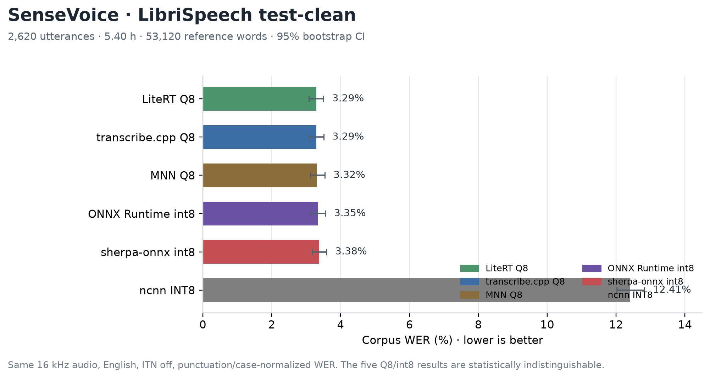

| Engine | Configuration | Corpus WER | 95% CI | Mean utterance WER | Empty outputs |
| --- | --- | ---: | ---: | ---: | ---: |
| LiteRT | Q8 | **3.2925%** | 3.0835–3.5053% | 3.9007% | 0 |
| transcribe.cpp | Q8, CUDA | **3.2944%** | 3.0770–3.5066% | 3.8951% | 0 |
| MNN | Q8 | 3.3151% | 3.1179–3.5420% | 3.9242% | 0 |
| ONNX Runtime | int8 | 3.3490% | 3.1446–3.5601% | 3.9550% | 0 |
| sherpa-onnx | int8 | 3.3754% | 3.1737–3.5919% | 4.0058% | 0 |
| ncnn | INT8 | 12.4078% | 12.0195–12.8184% | 12.7594% | 0 |

The five Q8/int8 engines are within **0.083 percentage points** of each other
(3.2925% to 3.3754%), and their confidence intervals overlap. This corpus does
not justify ranking them by WER. LiteRT Q8 and transcribe.cpp Q8 are tied at the
front within noise. ncnn INT8 is clearly worse at 12.41%; it also produced no
empty outputs, so this is a decoding/quantization quality issue rather than a
failed run.

WER by duration:

| Engine | 0–5 s | 5–10 s | 10–20 s | 20 s+ |
| --- | ---: | ---: | ---: | ---: |
| LiteRT Q8 | 4.19% | 3.13% | 2.87% | 3.64% |
| transcribe.cpp Q8 | 4.21% | 3.12% | 2.87% | 3.64% |
| MNN Q8 | 4.13% | 3.18% | 2.89% | 3.71% |
| ONNX Runtime int8 | 4.24% | 3.16% | 2.97% | 3.64% |
| sherpa-onnx int8 | 4.36% | 3.12% | 2.97% | 3.77% |
| ncnn INT8 | 11.63% | 11.17% | 12.82% | 16.55% |

Short utterances have higher WER because a single word error is a larger
fraction of the reference. Longer utterances are not uniformly better for ncnn,
which degrades further above 20 seconds.

## Qwen3-ASR: 1,000-utterance subset

The Qwen3-ASR 1.7B configurations in this subsection use a fixed random subset
drawn once with seed 1337 and shared with the SenseVoice results:

- **1,000 utterances**, 19,972 reference words.
- Same audio, references, normalization, and corpus-WER formula as above.
- Same random sample IDs for both models.

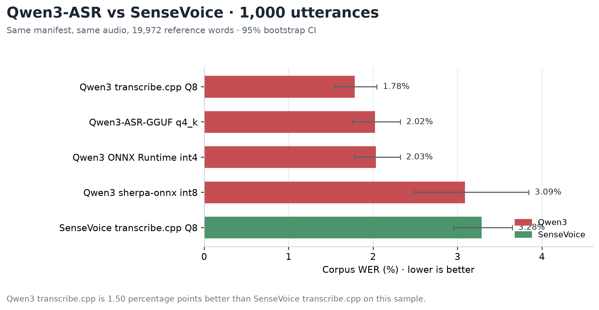

| Engine | Configuration | Corpus WER | 95% CI | Mean utterance WER | Empty outputs |
| --- | --- | ---: | ---: | ---: | ---: |
| Qwen3 transcribe.cpp | Q8, CUDA | **1.7825%** | 1.5399–2.0456% | 2.1473% | 0 |
| Qwen3 transcribe.cpp | F16, CUDA | 1.8226% | 1.5848–2.0640% | — | 0 |
| Qwen3 transcribe.cpp | BF16, CUDA | 1.8276% | 1.5941–2.0823% | — | 0 |
| Qwen3 ONNX Runtime | FP16, CUDA | 1.8876% | 1.6295–2.1509% | — | 0 |
| Qwen3-ASR-GGUF | q4_k, DML+Vulkan | 2.0228% | 1.7534–2.3233% | 2.2524% | 0 |
| Qwen3 ONNX Runtime | int4, CUDA | 2.0328% | 1.7772–2.3215% | 2.4056% | 0 |
| Qwen3 sherpa-onnx | int8, CPU | 3.0893% | 2.4813–3.8444% | 3.3640% | 2 |
| SenseVoice transcribe.cpp | Q8, CUDA | 3.2846% | 2.9515–3.6492% | 3.8964% | 0 |

Qwen3 transcribe.cpp is **1.50 percentage points better** than SenseVoice
transcribe.cpp on the same sample (1.78% vs 3.28%), a 46% relative reduction;
the confidence intervals do not overlap. Qwen3 F16/BF16 are within 0.05 points
of Q8 (1.82%/1.83%), and ORT FP16 is 1.89%, also better than SenseVoice. Qwen3
ONNX Runtime int4 and Qwen3-ASR-GGUF q4_k are about 2.02%. Qwen3 sherpa int8 is
nominally better than SenseVoice (3.09% vs 3.28%) but its interval is wide
because two of the 1,000 outputs were garbage/non-English; those two are counted
as errors. There is no ONNX BF16 export; BF16 is only available through
transcribe.cpp.

This reverses the impression from the single 23.86-second clip, where both
models happened to score 5.80%. This 1,000-utterance result is still a subset
and only covers read English.

## Qwen3-ASR 0.6B: full-corpus engine comparison

The compared configurations ran on the same 2,620 LibriSpeech test-clean utterances
and 53,120 reference words. WER uses the normalization and corpus-level formula
described above. EXL3 runs use the BF16 TensorRT encoder and greedy decoding.
Model initialization is excluded from full-run time; the run includes two warmup
utterances. Per-utterance latency includes audio loading and inference.

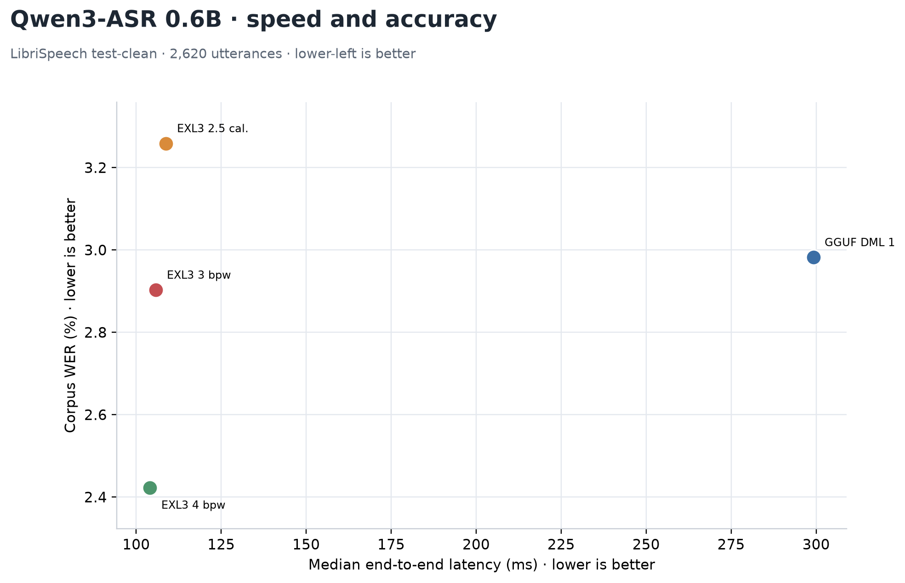

[SVG version](windows-librispeech-qwen3-0.6b-speed-accuracy.svg); [separate metric panels](windows-librispeech-qwen3-0.6b-comparison.png)

| Engine | Configuration | Corpus WER | Median ms | P90 ms | Full run s |
| --- | --- | ---: | ---: | ---: | ---: |
| Qwen3-ASR-GGUF | INT4 encoder + Q4_K decoder, DML adapter 1 + Vulkan | 2.982% | 299.2 | 406.3 | 830.5 |
| TensorRT + ExLlamaV3 | BF16 encoder + EXL3 3 bpw decoder | 2.878% | 103.4 | 217.6 | 323.3 |
| TensorRT + ExLlamaV3 | BF16 encoder + EXL3 2.5 bpw decoder, train-clean-100 calibration | 3.259% | 108.7 | 236.8 | 347.1 |
| TensorRT + ExLlamaV3 | BF16 encoder + EXL3 4 bpw decoder | **2.341%** | **96.7** | **208.4** | **305.7** |

The GGUF encoder used DirectML adapter 1 (RTX 4060 Laptop); its Q4_K decoder
used Vulkan. EXL3 3 and 4 bpw were 2.89x and 3.09x faster by median latency,
with WER lower by 0.104 and 0.641 percentage points. Among the EXL3 variants,
4 bpw was 6.9% faster than 3 bpw and had 0.537 points lower WER.

The earlier GGUF run did not specify a DirectML adapter and had a 277.9 ms
median. The pinned run had a 299.2 ms median, but all 2,620 hypotheses,
references, and IDs matched exactly between runs, so WER was unchanged. This
single-run timing difference should not be treated as an isolated adapter
speedup measurement.

## Qwen3-ASR 0.6B: decoder calibration comparison

The legacy 3 bpw decoder and the separately calibrated `train-clean-100`
variant were each run once on the same 2,620 test-clean utterances. Both runs
used the TensorRT BF16 encoder, ExLlamaV3 decoder, greedy decoding, and two
warmup utterances. Their IDs and references match exactly. The legacy decoder
was quantized with ExLlamaV3's default calibration data: 250 rows of 2,048
tokens. The new decoder uses 200 rows × 2,048 tokens packed from
1,603 paired audio requests and transcripts in `train-clean-100`.

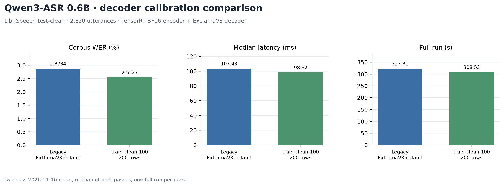

[SVG version](windows-librispeech-qwen3-0.6b-calibration-comparison.svg)

| Decoder | Calibration | Corpus WER | Edits | Median ms | P90 ms | Full run s |
| --- | --- | ---: | ---: | ---: | ---: | ---: |
| Legacy EXL3 3 bpw | 250 × 2,048; ExLlamaV3 default | 2.8784% | 1,529 | 103.43 | 217.62 | 323.31 |
| EXL3 3 bpw, `train-clean-100` | 200 × 2,048; 1,603 paired requests | **2.5527%** | **1,356** | 98.32 | 209.28 | 308.53 |

The new calibration reduced WER by 0.3257 percentage points (173 fewer total
edits). At utterance level it had fewer edits on 208 samples, the same count on
2,170, and more edits on 242. Median latency was 5.11 ms lower and full-run time
was 14.78 seconds shorter for the calibrated variant; these are single-pass
timings from the 2026-11-11 session. Aggregate
results and plotting code are in `docs/qwen3-0.6b-calibration-comparison.json`
and `tools/plot_qwen3_calibration_comparison.py`; per-utterance outputs remain
in the ignored
`.native/librispeech/qwen3-asr-0.6b-final2-rerun-20261111/` directory.

The `train-clean-100` variants are tuned for LibriSpeech-style English read
speech. For general-purpose audio and Chinese ASR, the legacy decoders, which
use ExLlamaV3's default calibration data, remain the default recommendation.

## Qwen3-ASR 0.6B: 4 bpw calibration comparison

The legacy 4 bpw decoder and the separately calibrated `train-clean-100` 4 bpw
variant were each run twice on the same 2,620 test-clean utterances, together
with the existing GGUF INT4 + Q4_K result. All runs use the same IDs and
references. The legacy decoder was quantized with ExLlamaV3's default
calibration data: 250 rows of 2,048 tokens. The new decoder uses 200 rows ×
2,048 tokens packed from 1,603 paired audio requests and transcripts in
`train-clean-100`.

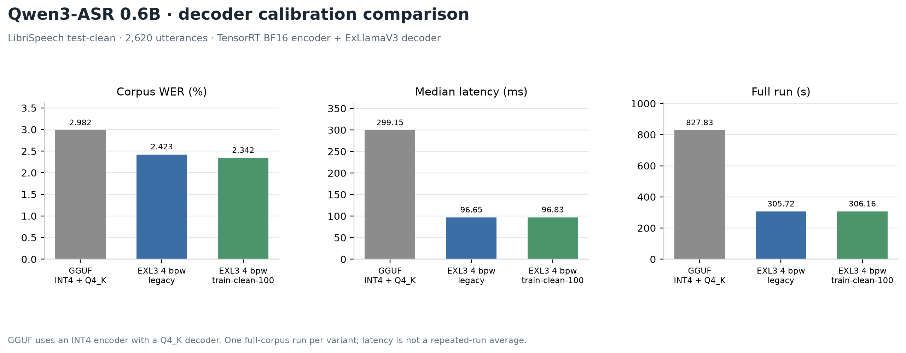

[SVG version](windows-librispeech-qwen3-0.6b-4bpw-calibration-comparison.svg)

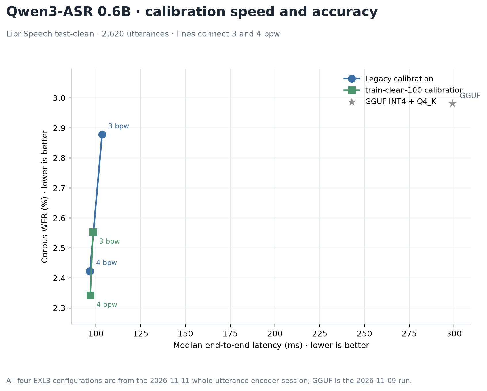

[SVG version](windows-librispeech-qwen3-0.6b-calibration-speed-accuracy.svg)

The line chart connects the 3 and 4 bpw points for each calibration family and
adds GGUF as a reference. All four EXL3 points come from the 2026-11-10
two-pass rerun; GGUF is the 2026-11-09 run.

| Decoder | Calibration | Corpus WER | Edits | Median ms | P90 ms | Full run s |
| --- | --- | ---: | ---: | ---: | ---: | ---: |
| GGUF INT4 + Q4_K | INT4 encoder, Q4_K decoder | 2.9819% | 1,584 | 299.15 | 403.80 | 827.83 |
| Legacy EXL3 4 bpw | 250 × 2,048; ExLlamaV3 default | 2.4228% | 1,287 | 96.65 | 208.36 | 305.72 |
| EXL3 4 bpw, `train-clean-100` | 200 × 2,048; 1,603 paired requests | **2.3419%** | **1,244** | 96.83 | 208.79 | 306.16 |

The calibrated 4 bpw decoder reduced WER by 0.0809 percentage points and 43
total edits. At utterance level it had fewer edits on 98 samples, the same
count on 2,396, and more edits on 126. Its median latency was 0.17 ms higher and
the full run 0.44 seconds longer, which is within run-to-run variation. The
encoder change moved both variants down from the 2026-11-09 figures (2.4228%
legacy stayed identical; the calibrated variant went from 2.3776% to 2.3419%).
Aggregate results and plotting code are
in `docs/qwen3-0.6b-4bpw-calibration-comparison.json`,
`docs/qwen3-0.6b-calibration-trends.json`, and
`tools/plot_qwen3_calibration_comparison.py`.

The small test-clean improvement does not make the calibrated 4 bpw variant a
general-purpose replacement. For Chinese and non-LibriSpeech audio, use the
legacy decoder, which was quantized with ExLlamaV3's default calibration data.

## Qwen3-ASR 1.7B: decoder calibration comparison

The legacy and `train-clean-100` 3 bpw and 4 bpw decoders were each run once on
the same 2,620 test-clean utterances. The existing GGUF INT4 + Q4_K result is
shown for reference. All TensorRT runs used the same BF16 encoder, greedy
decoding, and two warmup utterances. The legacy decoders were quantized with
ExLlamaV3's default calibration data; the calibrated variants use 200 rows
packed from `train-clean-100`.

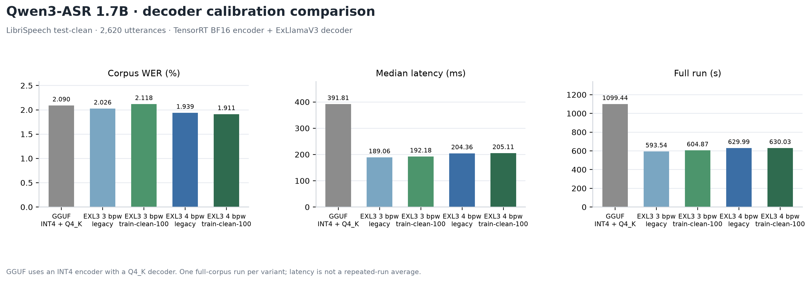

[SVG version](windows-librispeech-qwen3-1.7b-calibration-comparison.svg)

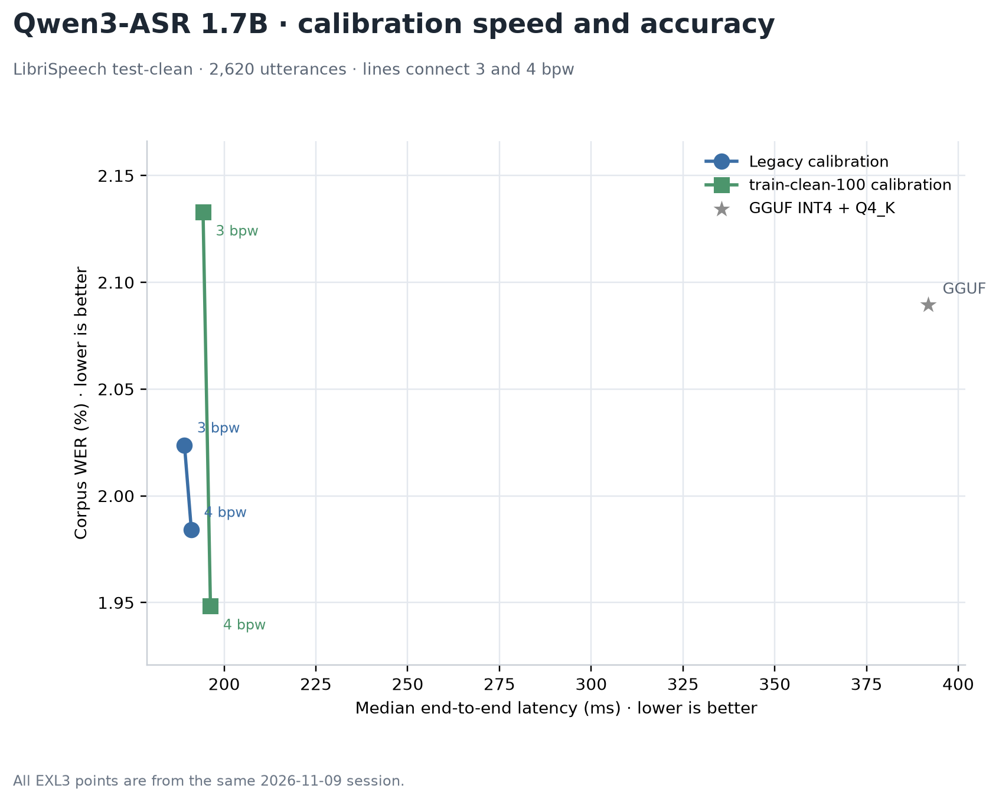

[SVG version](windows-librispeech-qwen3-1.7b-calibration-speed-accuracy.svg)

The line chart connects the 3 and 4 bpw points for each calibration family and
adds GGUF as a reference. All four EXL3 points are from the same session.

| Decoder | Calibration | Corpus WER | Edits | Median ms | P90 ms | Full run s |
| --- | --- | ---: | ---: | ---: | ---: | ---: |
| GGUF INT4 + Q4_K | INT4 encoder, Q4_K decoder | 2.0896% | 1,110 | 391.81 | 568.41 | 1,099.44 |
| Legacy EXL3 3 bpw | 250 × 2,048; ExLlamaV3 default | 2.0256% | 1,076 | 189.06 | 408.25 | 593.54 |
| EXL3 3 bpw, `train-clean-100` | 200 × 2,048; 1,603 paired requests | 2.1178% | 1,125 | 192.18 | 423.56 | 604.87 |
| Legacy EXL3 4 bpw | 250 × 2,048; ExLlamaV3 default | 1.9390% | 1,030 | 204.36 | 438.42 | 629.99 |
| EXL3 4 bpw, `train-clean-100` | 200 × 2,048; 1,603 paired requests | **1.9108%** | **1,015** | 205.11 | 440.84 | 630.03 |

The calibrated 4 bpw decoder reduced WER by 0.0282 percentage points and 15
total edits, with P90 latency 2.42 ms higher and median latency 0.75 ms higher.
At utterance level it had fewer edits on 70 samples, the same count on 2,481,
and more edits on 69. The calibrated 3 bpw decoder moved the other way: WER was
0.0922 points higher with 49 more edits, and median latency was 3.11 ms higher.
Its paired counts were 142 wins, 2,379 ties, and 99 losses. Calibration did not
improve the 1.7B 3 bpw tradeoff on test-clean. Aggregate results are in
`docs/qwen3-1.7b-calibration-comparison.json` and
`docs/qwen3-1.7b-calibration-trends.json`.

The calibrated 4 bpw variant has a small test-clean advantage, while the
calibrated 3 bpw variant is worse than legacy. For general-purpose audio and
Chinese ASR, the legacy decoders remain the default recommendation.

## Calibration comparison against GGUF and the official backend

The four EXL3 variants for each model are compared with the Qwen3-ASR-GGUF
INT4 encoder + Q4_K decoder reference and with the official `qwen-asr 0.0.6`
Transformers backend. All configurations use all 2,620 test-clean utterances.
Multipliers are GGUF median latency divided by the EXL3 median latency, so
larger is faster. The official backend uses BF16, two warmup utterances, and
excludes model load from the per-utterance timing. The `qwen-asr` vLLM backend
was not tested: vLLM 0.14.0 has no native Windows wheel.

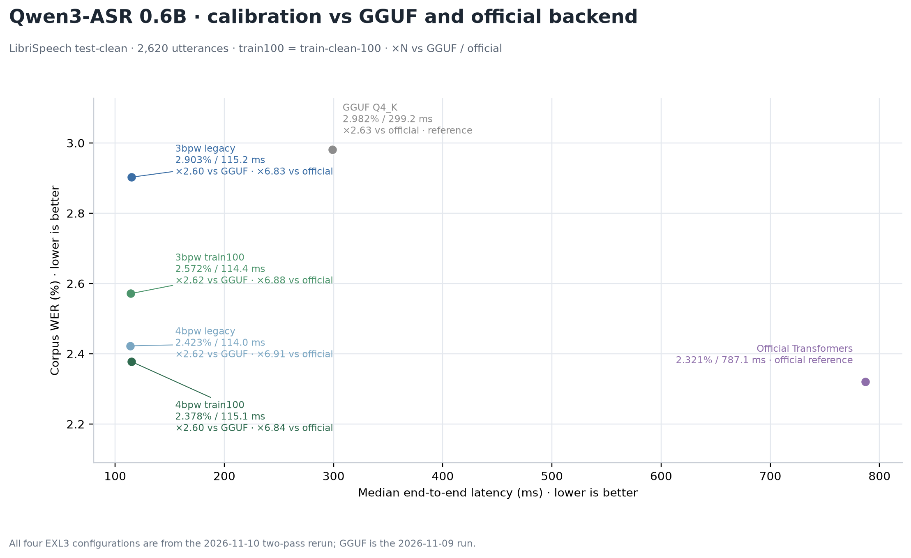

[SVG version](windows-librispeech-qwen3-0.6b-calibration-vs-gguf.svg)

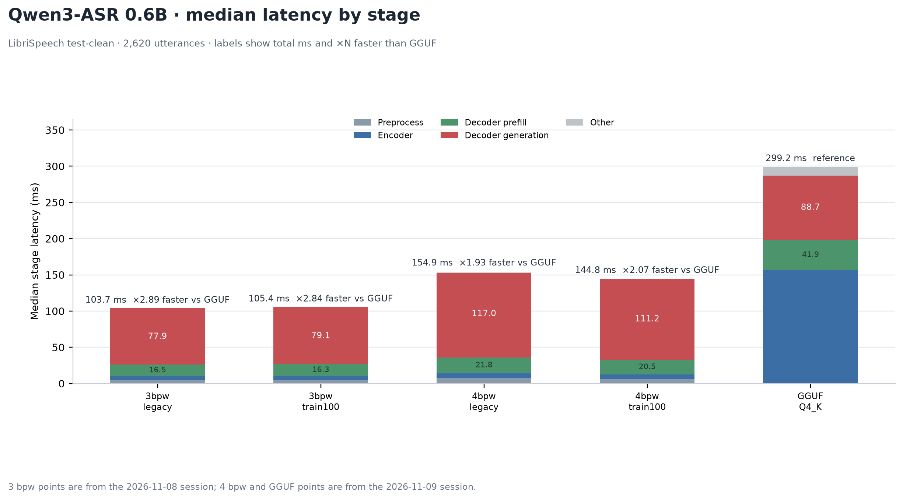

[SVG version](windows-librispeech-qwen3-0.6b-stage-latency.svg)

| 0.6B decoder | WER | Median ms | Speed vs GGUF | Speed vs official |
| --- | ---: | ---: | ---: | ---: |
| EXL3 3 bpw legacy | 2.8784% | 103.43 | ×2.89 | ×7.61 |
| EXL3 3 bpw train-clean-100 | 2.5527% | 98.32 | ×3.04 | ×8.01 |
| EXL3 4 bpw legacy | 2.4228% | 96.65 | ×3.10 | ×8.14 |
| EXL3 4 bpw train-clean-100 | **2.3419%** | 96.83 | ×3.09 | ×8.13 |
| GGUF Q4_K | 2.9819% | 299.15 | reference | ×2.63 |
| Official Transformers | **2.3212%** | 787.12 | ×0.38 | reference |

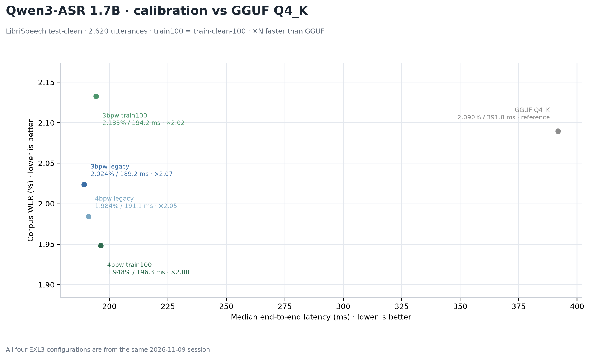

[SVG version](windows-librispeech-qwen3-1.7b-calibration-vs-gguf.svg)

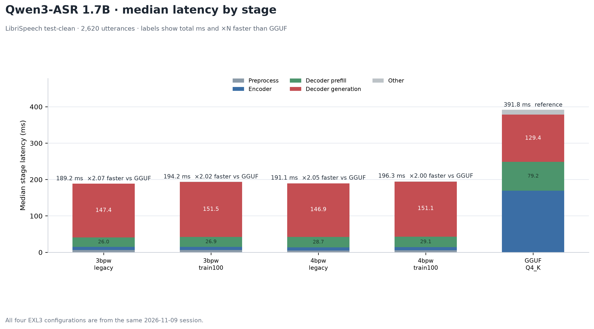

[SVG version](windows-librispeech-qwen3-1.7b-stage-latency.svg)

| 1.7B decoder | WER | Median ms | Speed vs GGUF | Speed vs official |
| --- | ---: | ---: | ---: | ---: |
| EXL3 3 bpw legacy | 2.0256% | 189.06 | ×2.07 | ×4.57 |
| EXL3 3 bpw train-clean-100 | 2.1178% | 192.18 | ×2.04 | ×4.49 |
| EXL3 4 bpw legacy | 1.9390% | 204.36 | ×1.92 | ×4.22 |
| EXL3 4 bpw train-clean-100 | **1.9108%** | 205.11 | ×1.91 | ×4.21 |
| GGUF Q4_K | 2.0896% | 391.81 | reference | ×2.20 |
| Official Transformers | **1.8863%** | 863.52 | ×0.45 | reference |

The EXL3 decoder paths are about 2.9–3.1× faster than GGUF Q4_K on 0.6B and
about 1.9–2.1× faster on 1.7B. GGUF Q4_K is itself 2.63× faster than the
official backend on 0.6B and 2.20× faster on 1.7B. The official Transformers
backend has the lowest WER in both tables, but it is 7.6–8.1× slower than EXL3
on 0.6B and 4.2–4.6× slower on 1.7B. The stage chart shows that most of the gap is in the encoder and decoder
generation stages; the exact stage values are printed on the bars.

## Qwen3-ASR 1.7B: full-corpus engine comparison

All six configurations ran on the same 2,620 test-clean utterances and
53,120 reference words, using the same seed-1337 manifest. EXL3 runs use the
BF16 TensorRT encoder and greedy decoding; GGUF uses its INT4 encoder and Q4_K
decoder. EXL3 rows use the aligned memory-profile reruns; the GGUF row is a new
run with DirectML adapter 1. Model initialization is excluded; each run
includes two warmup utterances.
Per-utterance latency includes audio loading and inference. All runs produced
zero empty outputs, and IDs and references match across engines.

The GGUF runner sets `onnx_provider="DML"` and `llm_use_gpu=True`. This rerun
explicitly passed DirectML adapter 1 to both encoder ONNX sessions; Vulkan
handles the GGUF decoder. The earlier run left the DirectML adapter at its
default. Both runs produced identical hypotheses for all 2,620 utterances.
No ONNX Runtime node-level profiling was saved, so this confirms the selected
provider and adapter but not that every ONNX operator ran on DirectML.

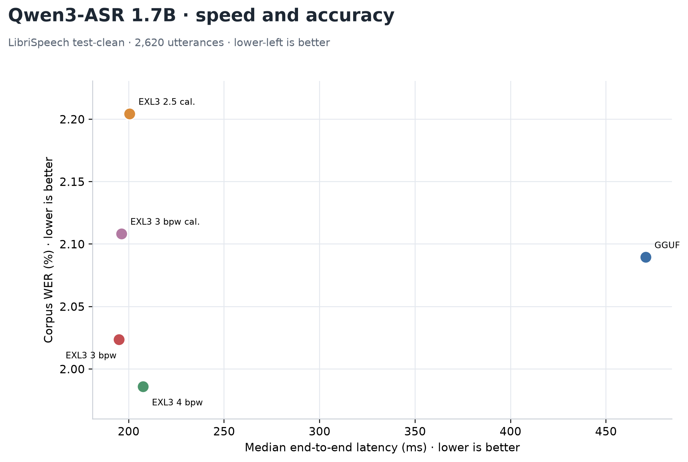

[SVG version](windows-librispeech-qwen3-1.7b-speed-accuracy.svg); [separate metric panels](windows-librispeech-qwen3-1.7b-comparison.png)

| Engine | Configuration | Corpus WER | Median ms | P90 ms | Full run s |
| --- | --- | ---: | ---: | ---: | ---: |
| Qwen3-ASR-GGUF | INT4 encoder + Q4_K decoder, DML adapter 1 + Vulkan | 2.090% | 391.8 | 568.4 | 1,099.4 |
| TensorRT + ExLlamaV3 | BF16 encoder + EXL3 2.5 bpw, train-clean-100 calibration | 2.204% | 200.5 | 433.1 | 624.6 |
| TensorRT + ExLlamaV3 | BF16 encoder + EXL3 2 bpw, train-clean-100 calibration (retired) | 2.899% | 158.2 | 336.1 | 497.5 |
| TensorRT + ExLlamaV3 | BF16 encoder + EXL3 3 bpw decoder | 2.026% | 189.1 | 408.3 | 593.5 |
| TensorRT + ExLlamaV3 | BF16 encoder + EXL3 3 bpw, train-clean-100 calibration | 2.118% | 192.2 | 423.6 | 604.9 |
| TensorRT + ExLlamaV3 | BF16 encoder + EXL3 4 bpw decoder | **1.939%** | **204.4** | **438.4** | **630.0** |

EXL3 3 bpw was 2.07x faster than GGUF by median latency and had 0.064
percentage points lower WER. EXL3 4 bpw was 1.92x faster and had 0.151
percentage points lower WER. Calibrated EXL3 3 bpw was 2.04x faster than GGUF,
with WER 0.028 points higher. On this corpus, 4 bpw reduced WER by 0.087
points versus legacy 3 bpw, while legacy 3 bpw was 8.1% faster by
median latency. Pairwise edit counts were 133 wins, 2,296 ties, and 191 losses
for calibrated 2.5 bpw versus GGUF; 150, 2,341, and 129 for 3 bpw versus GGUF;
142, 2,379, and 99 for 4 bpw versus GGUF; 141, 2,315, and 164 for calibrated
and 120, 2,348, and 152 for calibrated versus legacy
3 bpw.

Calibrated 2.5 bpw was 2.35x faster than GGUF, with WER 0.115 points higher.
It was 2.8% slower than legacy 3 bpw and had WER 0.181 points higher;
its measured GPU memory increase was 47 MiB higher. It did not improve the
speed, accuracy, or memory tradeoff over legacy 3 bpw in this run.

Compared with legacy 3 bpw, calibrated 3 bpw was 0.6% slower and WER was
0.085 points higher; paired edit counts were 120 wins, 2,348 ties, and 152
losses. Calibration did not improve this 3 bpw result on test-clean.

The calibrated 2 bpw run was 23.8% faster than 4 bpw and 2.48x faster than
GGUF, but its WER was 0.913 percentage points higher than 4 bpw and 0.809
points higher than GGUF. It is recorded as a speed-oriented experiment, not a
recommended configuration. This variant is retired; it is kept for reference
only and is not part of the supported decoder set.

The earlier unpinned GGUF run had a 423.7 ms median; the adapter-1 run measured
391.8 ms. Its 2,620 IDs, references, and hypotheses exactly match the earlier
run, so corpus WER is unchanged.

## GPU memory and INT4/INT8 encoder comparison

The memory figures below come from separate earlier GPU-wide sampling runs.
Those GGUF memory runs did not specify a DirectML adapter; the new adapter-1
timing runs did not record a memory peak, so they do not update the GGUF memory
rows.

This follow-up measured the GGUF INT4/Q4_K baseline, TensorRT BF16 encoder with
EXL3 2.5 bpw, 3 bpw and 4 bpw decoders, and TensorRT INT4 and INT8 encoders
with the 4 bpw decoder on the same full test-clean set. Each configuration has
2,620 utterances, 53,120 reference words, and zero empty outputs. GGUF 0.6B was
run with the explicit `model-0.6b` directory. The TensorRT runs used the
matching 0.6B or 1.7B encoder and decoder artifacts.

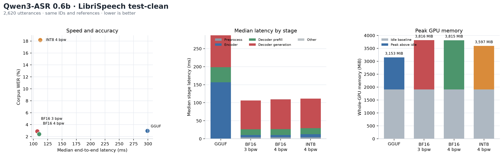

[0.6B SVG](windows-librispeech-qwen3-0.6b-memory.svg)

| Configuration | WER | Median / P90 ms | Encoder ms | Decoder prefill / generation ms | Incremental GPU memory |
| --- | ---: | ---: | ---: | ---: | ---: |
| GGUF INT4 + Q4_K | 2.982% | 299.2 / 403.8 | 156.57 | 41.88 / 88.67 | 1,242 MiB |
| BF16 + EXL3 3 bpw | 2.903% | 105.7 / 233.3 | 5.96 | 16.16 / 78.76 | 1,945 MiB |
| BF16 + EXL3 4 bpw | **2.423%** | **104.1 / 231.2** | 5.89 | 15.29 / 78.01 | 1,914 MiB |
| INT4 encoder + EXL3 4 bpw | 2.613% | 132.4 / 276.6 | 6.11 | 21.40 / 100.75 | 2,423 MiB |
| BF16 + EXL3 2.5 bpw, train-clean-100 calibration | 3.259% | 108.7 / 236.8 | 6.05 | 16.12 / 79.73 | 1,983 MiB* |
| BF16 + EXL3 2 bpw, train-clean-100 calibration (retired) | 8.471% | 113.3 / 255.0 | 5.89 | 16.82 / 84.19 | 1,830 MiB |
| INT8 + EXL3 4 bpw | 18.178% | 111.8 / 248.2 | 7.99 | 16.66 / 82.11 | 1,689 MiB |

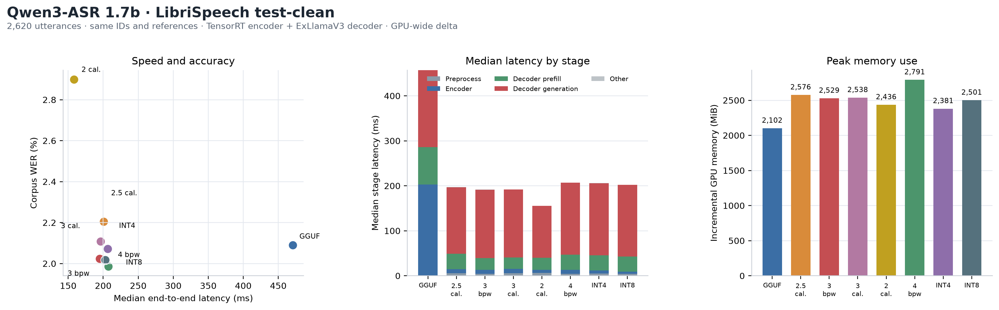

[1.7B SVG](windows-librispeech-qwen3-1.7b-memory.svg)

| Configuration | WER | Median / P90 ms | Encoder ms | Decoder prefill / generation ms | Incremental GPU memory |
| --- | ---: | ---: | ---: | ---: | ---: |
| GGUF INT4 + Q4_K | 2.090% | 470.7 / 676.4 | 202.79 | 83.42 / 171.06 | 2,102 MiB |
| BF16 + EXL3 3 bpw | 2.024% | 195.0 / 430.5 | 9.21 | 26.14 / 151.75 | 2,529 MiB |
| BF16 + EXL3 3 bpw, train-clean-100 calibration | 2.108% | 196.2 / 434.3 | 9.30 | 25.80 / 150.92 | 2,538 MiB |
| BF16 + EXL3 2.5 bpw, train-clean-100 calibration | 2.204% | 200.5 / 433.1 | 9.23 | 33.94 / 148.00 | 2,576 MiB |
| BF16 + EXL3 2 bpw, train-clean-100 calibration (retired) | 2.899% | 158.2 / 336.1 | 7.23 | 26.32 / 115.71 | 2,436 MiB |
| BF16 + EXL3 4 bpw | **1.986%** | 207.5 / 448.3 | 9.25 | 33.57 / 159.58 | 2,791 MiB |
| INT4 encoder + EXL3 4 bpw | 2.073% | 206.4 / 447.6 | 7.27 | 33.43 / 160.51 | 2,381 MiB |
| INT8 + EXL3 4 bpw | 2.018% | 202.7 / 436.7 | 4.89 | 33.53 / 159.43 | 2,501 MiB |

INT4's impact differs by model. On 1.7B, it lowered the measured GPU memory
increase by 410 MiB and median latency by 0.6% versus BF16, with WER higher by
0.087 percentage points. On 0.6B, it increased memory by 509 MiB and median
latency by 27%, with WER higher by 0.190 percentage points. INT4 weight-only did not
improve the 0.6B run.

The INT8 result depends strongly on model size. On 1.7B, INT8 reduced median
encoder time from 9.25 ms to 4.89 ms and whole-GPU peak use by 292 MiB compared
with BF16 + EXL3 4 bpw. End-to-end median latency improved by 2.3%, while WER
increased by 0.032 percentage points (1.986% to 2.018%). On 0.6B, INT8 made
the encoder slower (6.00 ms to 7.99 ms), changed median end-to-end latency from
110.0 ms to 111.8 ms, and increased WER by 15.755 percentage points. It is not
a suitable accuracy-preserving replacement for the 0.6B BF16 encoder in this
measurement.

For 0.6B, the calibrated 2.5 bpw decoder was slower than 4 bpw in the matched reruns,
with higher WER and a 69 MiB higher whole-GPU memory delta. Its 568 MB weight
file saves about 95 MB from the 4 bpw file, but this did not translate into a
lower measured GPU peak. The 2 bpw candidate was also 8.9% slower than 4 bpw,
with WER higher by 6.049 percentage points. It saved about 105 MB in weights
and 84 MiB in measured GPU memory, which does not offset the quality loss. The
2 bpw variant is retired.

* The 0.6B 2.5 bpw memory figure is one whole-GPU sample: idle 178 MiB and peak
  2,161 MiB, sampled every 500 ms. The matched 4 bpw run had 203 MiB idle and
  2,117 MiB peak. These samples include Windows GPU clients and are not
  process-isolated allocations.

Memory is sampled from `nvidia-smi` every 500 ms and represents total GPU memory
use, including Windows and other GPU clients; the displayed estimate is peak
whole-GPU use minus the idle baseline, not process-isolated allocation. It also
includes TensorRT/ExLlamaV3 runtime allocations and the decoder KV cache, so it
is a run-level GPU increase rather than weights-only memory. The
device reported by this run was an NVIDIA GeForce RTX 4060 Laptop GPU with
8,188 MiB. Stage values are per-utterance medians. GGUF's `decodeMs` and
TensorRT + ExLlamaV3's `decoderGenerationMs` are both decoder generation time.
The latter runs in ExLlamaV3 on CUDA; TensorRT accelerates only the audio
encoder. GGUF's `encoderMs` measures ONNX encoder time. On 0.6B, EXL3 4 bpw
reduced median decoder prefill from 41.88 to 15.29 ms (2.74x) and generation
from 88.67 to 78.01 ms (1.14x). On 1.7B, EXL3 3 bpw reduced prefill from 83.42
to 26.14 ms (3.19x) and generation from 171.06 to 151.75 ms (1.13x). Decoder
generation gains are modest; most of the decoder-stage improvement is in
prefill, and the larger end-to-end speedup also includes the much faster
TensorRT encoder. These are per-utterance stage medians, not token-normalized
throughput.

EXL3 decoder files occupy 607/662 MB (0.6B 3/4 bpw) and 1,399/1,575 MB (1.7B).
The runtime preallocates an 8,192-token FP16 KV cache, about 896 MiB for each
model at batch size one. The 0.6B 3/4-bpw weight files differ by 55 MB, while
their sampled GPU peaks differ by only 1 MiB; allocator reservations and the
GPU-wide peak sampling do not resolve that small change. For 1.7B, the weight
files differ by 176 MB and the measured run deltas differ by 262 MiB. The GGUF and TensorRT
figures are not strictly like-for-like process allocations: they are sampled
whole-GPU peaks, include runtime/context/workspace overhead, and may miss short
peaks between 500 ms samples. This explains why EXL3 can show a larger GPU
increase than GGUF even when decoder weights are similar: TensorRT adds the
encoder engine and workspace, and ExLlamaV3 adds its CUDA context and fixed KV
cache. The GGUF baseline uses a different runtime and allocator.

## Train-clean-100 calibration and low-precision encoders

The earlier INT8 encoders were calibrated from `test-clean`, which overlaps the
evaluation set. They were recalibrated using 32 speakers and chapters sampled
from LibriSpeech `train-clean-100` (59 encoder windows per model). The official
archive is retained locally at `.native/calibration/train-clean-100.tar.gz`
(6,387,309,499 bytes). Its MD5 `2a93770f6f5c6c964bc36631d331a522` matches the
OpenSLR checksum, and its SHA-256 is
`d4ddd1d5a6ab303066f14971d768ee43278a5f2a0aa43dc716b0e64ecbbbf6e2`. The sample
was extracted with `tools/extract_librispeech_calibration.py` using seed 1337:
32 speakers, 32 chapters, 1,776 FLAC files, and 32 chapter transcripts. Repacking
the sample reproduced the decoder calibration tensor used for the 2 bpw run
byte-for-byte (SHA-256
`51b54f6c1995d1dee36f3c1d01782c33501a3bb981f7f3f3109213749a2988a0`).

Cosine is measured frame by frame between candidate TensorRT embeddings and the
FP16 TensorRT encoder on all 2,620 test-clean utterances (253,326 frames). WER
and latency use the same corpus and EXL3 4 bpw decoder. The model-level results
are:

| Model | Encoder | Embedding cosine mean / P05 | Encoder median ms | End-to-end median ms | WER |
| --- | --- | ---: | ---: | ---: | ---: |
| 0.6B | FP16 reference | 1.000 / 1.000 | 6.00 | 110.0 | 2.423% |
| 0.6B | INT4 weight-only | 0.963 / 0.925 | 6.10 | 135.8 | 2.613% |
| 0.6B | INT8 QDQ, train-clean-100 | 0.756 / 0.598 | 8.81 | 127.3 | 16.860% |
| 1.7B | FP16 reference | 1.000 / 1.000 | 9.25 | 207.5 | 1.986% |
| 1.7B | INT4 weight-only | 0.974 / 0.952 | 7.46 | 210.7 | 2.073% |
| 1.7B | INT8 QDQ, train-clean-100 | 0.934 / 0.850 | 11.90 | 210.1 | 2.033% |

INT4 quantizes the 111/147 constant MatMul weights in the 0.6B/1.7B encoders
using 64-value weight blocks; convolutions and activations remain FP16. The
TensorRT engines build and run. The earlier precision runs showed a faster
1.7B INT4 encoder stage but a 210.7 ms end-to-end median versus 207.5 ms for
the FP16 reference. A later memory-profile rerun measured 206.4 ms versus
207.5 ms for BF16; that 0.6% difference is too small to establish a repeatable
speedup. INT8 retains near-reference WER on 1.7B but is slower than FP16 in the
earlier stage run; 0.6B INT8 is unusable at 16.860% WER. The current recommended
encoder remains BF16 on 4060 class hardware, with FP16 available for hardware
without BF16.

This is weight-only INT4: TensorRT dequantizes the packed weights before
high-precision GEMM, and does not quantize activations. The GGUF encoder
quantization script also targets MatMul weights only, with 4-bit blocks of 16,
and reads `.fp32.onnx` inputs. Its `test_quant_accuracy.py` compares one
`test.mp3` on CPU and calculates one cosine over flattened embeddings. Those
results are not directly comparable to this report's frame-wise mean and P05
over 2,620 test-clean utterances against a TensorRT FP16 reference. The reported
GGUF value near 96% is consistent in scale with this project's 96.3% (0.6B)
and 97.4% (1.7B), but it is not the same measurement.

For the tested full-pipeline configurations, 0.6B BF16 encoder + EXL3 4 bpw
with `train-clean-100` calibration has the lowest measured WER (2.378%); the
legacy 4 bpw variant measured 2.423%. For 1.7B, BF16 + EXL3 4 bpw with
`train-clean-100` calibration has the lowest WER (1.948%); legacy 4 bpw
measured 1.984%. The calibrated 3 bpw variants did not improve on their
legacy counterparts: 1.7B calibrated 3 bpw was 0.109 points worse.
Median latency for 0.6B in this session is higher than earlier tables and
should only be compared within the calibration figure. The 2 bpw experiment is
retired and is not part of the supported decoder set.

These test-clean gains do not establish a general improvement. The
`train-clean-100` variants are tuned for LibriSpeech-style English read speech;
for general-purpose audio and Chinese ASR, the legacy decoders, which use
ExLlamaV3's default calibration data, remain the default recommendation.

The cosine values describe embedding direction, not transcript accuracy. The
low cosine tail, especially on 0.6B INT8, tracks the WER regression but does not
establish a general cosine-to-WER relationship. Whole-GPU memory is sampled
separately from these stage runs and includes Windows clients, TensorRT runtime
allocations, and the decoder KV cache; it is not a process-only encoder memory
measurement.

Decoder calibration was packed from 1,603 paired `train-clean-100` audio
requests and transcripts into 200 rows of 2,048 token IDs using the Qwen3-ASR
tokenizer. Each request contains its actual audio placeholder span and English
ASR task prefix. ExLlamaV3 consumes token IDs, so these rows represent the text
prompt and transcript distribution; they do not contain encoder audio
embeddings. These rows were used for the 0.6B and 1.7B 2 and 2.5 bpw decoders,
plus the 1.7B 3 bpw decoder. All three calibrated 1.7B decoders were
evaluated on all 2,620 test-clean utterances; their speed, WER, stage timings
and memory samples are listed above.

Raw per-utterance records and memory samples are kept under
`.native/librispeech/qwen3-asr-memory-full-test-clean/` and are not committed.
The calibration WER and latency results are recorded in the tables above; raw
per-run summaries remain local.

## Qwen3-ForcedAligner 0.6B: TensorRT encoder + decoder backends

The Qwen3-ForcedAligner 0.6B encoder was exported to ONNX and built with
TensorRT BF16. Two decoder builds are measured: EXL3 4 bpw and a fully
TensorRT decoder. The aligner decoder is a single forward pass with no KV cache,
so the TensorRT build takes pre-built `inputs_embeds`, gathers the hidden states
at the timestamp positions, and applies only the 5,000-row classification head,
which removes both the padded 152,064-row head and all per-layer Python dispatch.
Both bf16 and fp16 engines were built and benchmarked. The official Transformers,
GGUF, EXL3, and TensorRT backends were run on all 2,620 test-clean utterances
with the reference transcript as input.

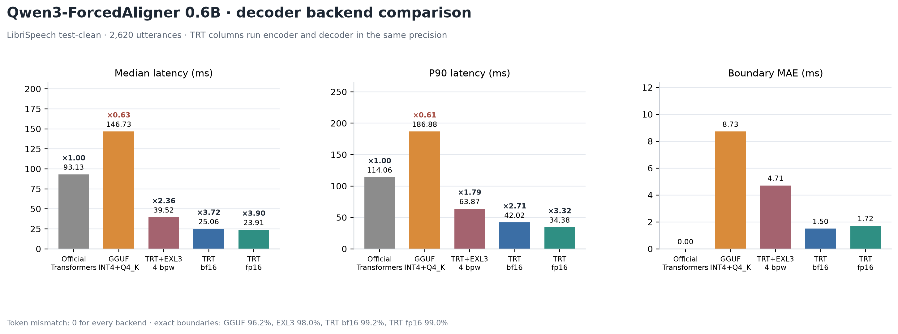

[SVG version](windows-librispeech-qwen3-aligner-comparison.svg)

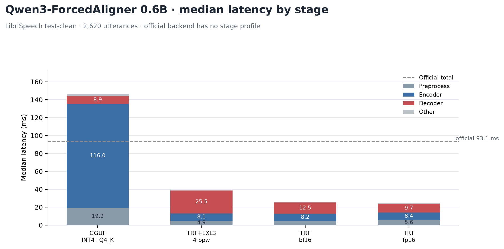

[SVG version](windows-librispeech-qwen3-aligner-stage-latency.svg)

| Backend | Median ms | P90 ms | RTF | Exact boundaries | Boundary MAE |
| --- | ---: | ---: | ---: | ---: | ---: |
| Official Transformers BF16 | 93.13 | 114.06 | 0.0130 | — | — |
| GGUF INT4 + Q4_K | 139.55 | 182.02 | 0.0190 | 96.2% | 8.73 ms |
| TensorRT + EXL3 4 bpw | 39.52 | 63.87 | 0.0058 | 98.0% | 4.71 ms |
| **TensorRT bf16 (encoder + decoder)** | 25.06 | 42.02 | 0.0039 | **99.2%** | **1.50 ms** |
| **TensorRT fp16 (encoder + decoder)** | **23.91** | **34.38** | **0.0035** | 99.0% | 1.72 ms |

Both TensorRT columns run the audio encoder and the text decoder in the same
precision, so each column measures one dtype end to end. The TensorRT decoder is
3.90× faster than the official backend and 5.84× faster than GGUF by median
latency. All five backends produced the same token sequence on every utterance.
The TensorRT decoder stage drops from 25.5 ms with EXL3 to 11.5 ms with the bf16
engine and 9.7 ms with the fp16 engine, because the same forward pass went from
956 kernel launches to a single engine call.

### Whole-utterance audio encoding

The encoder originally split audio into independent 800-frame inference windows.
Profiling showed that the reference implementation never windows: it runs with the
`sdpa` attention backend, which ignores the `cu_seqlens` argument, so every audio
token attends to every other token. Encoding the same 800 frames as part of a
longer utterance therefore changes their embeddings, and independent windows
cannot reproduce that result:

| Comparison (1,043-frame utterance) | cos mean |
| --- | ---: |
| Reference global attention: first 104 tokens vs standalone 800 frames | 0.9973 |
| Reference with windowed attention patched in: same comparison | 1.0000 |

The encoder now runs one pass over the whole utterance, padded to a multiple of
100 frames, with full attention over all tokens. Agreement against the reference
moved from 97.3% to 99.2% exact boundaries and from 7.0 ms to 1.5 ms MAE, and the
gap between short and long utterances disappeared:

| Audio length | Exact boundaries | Boundary MAE |
| --- | ---: | ---: |
| ≤ 8 s | 99.1% | 1.69 ms |
| > 8 s | 98.9% | 2.37 ms |

Padding to a 100-frame chunk instead of an 800-frame window also made short
utterances cheaper: the encoder stage is unchanged at 8.4 ms median, but audio
under 3 s now costs about 6 ms instead of a flat 8.7 ms.

The remaining differences are bf16 rounding between two different execution
graphs: feeding PyTorch audio embeddings into the TensorRT decoder produces zero
argmax differences over 1,486 timestamp positions, and an fp32 TensorRT decoder
scores the same as the bf16 engine. Running the whole pipeline in fp16 instead of
bf16 keeps the same token sequence and lands within 0.2 points of the bf16
boundary agreement, so the two TensorRT columns differ by dtype rather than by
implementation.

The ASR audio encoder shares this code, so both ASR encoders were rebuilt and the
full corpora re-run on 2026-11-11. WER for 0.6B is unchanged at 2.423% (1,287
edits); 1.7B improves from 1.986% to 1.939% (1,030 edits). 233 of the 2,620 0.6B
transcripts changed, mostly punctuation, which the WER normalisation drops. The
encoder stage moves by about 1 ms in both directions: 0.6B 6.29 → 5.42 ms, 1.7B
8.34 → 8.64 ms, because the dynamic engine trades some kernel specialisation for
correctness and computes every token once instead of padding to whole windows.

The stage chart shows the TensorRT bf16 run's median 25.1 ms split into
preprocessing 5.1 ms, encoder 8.1 ms, decoder 11.5 ms, and a small remainder.
GGUF's 139.5 ms is dominated by its 108.2 ms encoder and 26.6 ms decoder. The
official backend is shown as a 93.1 ms reference line because it does not expose
a stage profile.

The GGUF stage split was re-measured because its original decoder figure covered
only `ctx.decode`. The embedding-table gather, the `LlamaBatch` construction, and
the timestamp argmax all sat outside that timer and were folded into the
preprocessing bucket, which reported 19.2 ms. Timing them separately gives
decoder 26.6 ms (embed 1.1 ms + decode 25.5 ms), argmax 0.3 ms, and 0.7 ms of
remaining preprocessing, with the same 139.5 ms end to end. The corrected split
is now the one plotted, so the decoder comparison uses the same window for all
four backends.

The CLI supports `--format json`, `--format srt`, and `--format txt` for the same
aligned item list, so the output can be consumed directly or converted to subtitles.
`--decoder-precision bf16` is the default, which matches the reference dtype.
`--decoder-precision fp16` is about 8% faster; the encoder follows the decoder
unless `--encoder-precision` is set, so each column stays single-precision.
`--backend tensorrt-exllama` selects the EXL3 decoder instead.


## What changed from the single clip

The 23.86-second sample produced 5.80% WER for the Q8 engines; the full corpus
produces about 3.3%. The single clip is not a miniature estimate of corpus WER:
it contains unusual spellings and a small number of words. The corpus result is
the number to use for accuracy comparisons.

The earlier single-clip Qwen3 numbers (5.80%) should not be compared directly
to the full SenseVoice table. The 1,000-utterance Qwen3 1.7B subset and the
full-corpus 0.6B/1.7B comparisons above use different model configurations.

## Coverage and limitations

- Included: full-corpus SenseVoice with LiteRT Q8, MNN Q8, ONNX Runtime int8,
  sherpa-onnx int8, ncnn INT8, and transcribe.cpp Q8.
- The Qwen3 1.7B configurations above use a common 1,000-utterance subset:
  transcribe.cpp Q8/F16/BF16, ONNX Runtime int4/FP16, Qwen3-ASR-GGUF q4_k, and
  sherpa-onnx int8. The separate 0.6B and 1.7B engine comparisons use all
  2,620 utterances.
  There is no ONNX BF16 export.
- The 1.7B subset table does not include the custom `benchmark_gguf_smoke.exe`
  or TensorRT runner. The 0.6B and 1.7B full-corpus comparisons above include
  GGUF and TensorRT + ExLlamaV3. The transcribe.cpp result covers the same GGUF Q8
  weights with a persistent model.
- This is read English speech. It does not measure noisy audio, multilingual
  audio, long-form segmentation, or ITN.
- Raw per-utterance JSONL and summaries are in
  `.native/librispeech/sensevoice-wer/`,
  `.native/librispeech/qwen3-wer-1000/`,
  `.native/librispeech/qwen3-asr-1.7b-full-test-clean/`,
  `.native/librispeech/qwen3-transcribe-f16-1000/`,
  `.native/librispeech/qwen3-transcribe-bf16-1000/`, and
  `.native/librispeech/qwen3-ort-fp16-1000/` and are not committed.

## Reproduction

```powershell
tar -xf test-clean.tar.gz -C .native/librispeech
.native/model-env/Scripts/python.exe tools/prepare_librispeech.py
.native/model-env/Scripts/python.exe tools/sensevoice_wer.py `
  --output-dir .native/librispeech/sensevoice-wer `
  --engines sherpa ort mnn ncnn litert
.native/transcribe-env/Scripts/python.exe tools/sensevoice_wer.py `
  --output-dir .native/librispeech/sensevoice-wer `
  --engines transcribe --transcribe-device cuda
```

Qwen3 on the same 1,000-utterance sample:

```powershell
.native/transcribe-env/Scripts/python.exe tools/qwen3_wer.py `
  --output-dir .native/librispeech/qwen3-wer-1000 `
  --engines transcribe --transcribe-device cuda
.native/model-env/Scripts/python.exe tools/qwen3_wer.py `
  --output-dir .native/librispeech/qwen3-wer-1000 --engines sherpa
.native/gpu-env/Scripts/python.exe tools/qwen3_wer.py `
  --output-dir .native/librispeech/qwen3-wer-1000 --engines ort
.native/qwen-gguf-env/Scripts/python.exe tools/qwen3_wer.py `
  --output-dir .native/librispeech/qwen3-wer-1000 --engines gguf
.native/transcribe-env/Scripts/python.exe tools/qwen3_wer.py `
  --output-dir .native/librispeech/qwen3-transcribe-f16-1000 `
  --engines transcribe --transcribe-device cuda `
  --transcribe-model .native/models/qwen3-asr/transcribe/Qwen3-ASR-1.7B-F16.gguf
.native/transcribe-env/Scripts/python.exe tools/qwen3_wer.py `
  --output-dir .native/librispeech/qwen3-transcribe-bf16-1000 `
  --engines transcribe --transcribe-device cuda `
  --transcribe-model .native/models/qwen3-asr/transcribe/Qwen3-ASR-1.7B-BF16.gguf
.native/gpu-env/Scripts/python.exe tools/qwen3_wer.py `
  --output-dir .native/librispeech/qwen3-ort-fp16-1000 --engines ort `
  --ort-model .native/models/qwen3-asr/ort-fp16
```

Each engine writes `*.jsonl` plus a `*.summary.json`. The report chart is
generated by `tools/plot_sensevoice_wer.py` and `tools/plot_qwen3_wer.py`.

### Aligner and the 2026-11-11 reruns

Everything below runs from data under `.native/`, which is git-ignored. The
charts and JSON reports in `docs/` are committed, so the figures survive without
it; the steps here rebuild the raw runs.

Inputs to place under `.native/`:

| Path | Contents |
| --- | --- |
| `.native/librispeech` | LibriSpeech `test-clean` plus `manifest.jsonl` from `tools/prepare_librispeech.py` |
| `.native/qwen3-asr-gguf` | clone of `HaujetZhao/Qwen3-ASR-GGUF`; `aligner-model/` unpacked from the `Qwen3-ForceAligner-0.6B-gguf.zip` release |
| `.native/qwen-gguf-env` | Python environment that provides the repository's `llama` bindings |
| `../Qwen3-ASR-TensorRT/artifacts` | TensorRT engines and EXL3 decoders built by `qwen3-asr build` / `build-aligner` |

The GGUF aligner only times `ctx.decode`, so apply the finer timers before
running it, otherwise roughly 16 ms of decoder work is reported as
preprocessing:

```powershell
python tools/patch_gguf_aligner_timing.py .native/qwen3-asr-gguf
```

Aligner runs, one directory each:

```powershell
python tools/qwen3_aligner_bench.py --backend official --limit 2620 `
  --aligner-model ../Qwen3-ASR-TensorRT/models/Qwen3-ForcedAligner-0.6B `
  --output-dir .native/librispeech/qwen3-asr-aligner-official-full-test-clean

.native/qwen-gguf-env/Scripts/python.exe tools/qwen3_aligner_bench.py --backend gguf `
  --limit 2620 --gguf-repo .native/qwen3-asr-gguf `
  --gguf-model-dir .native/qwen3-asr-gguf/aligner-model `
  --output-dir .native/librispeech/qwen3-asr-aligner-gguf-timed-full

python tools/qwen3_aligner_bench.py --backend exllama --limit 2620 `
  --output-dir .native/librispeech/qwen3-asr-aligner-exl3-dyn-full-test-clean
python tools/qwen3_aligner_bench.py --backend trt-bf16 --limit 2620 `
  --output-dir .native/librispeech/qwen3-asr-aligner-trt-bf16-pure-full
python tools/qwen3_aligner_bench.py --backend trt-fp16 --limit 2620 `
  --output-dir .native/librispeech/qwen3-asr-aligner-trt-fp16-pure-full
```

ASR calibration runs, four configurations per model, 2,620 utterances each:

```powershell
python tools/qwen3_wer.py --engines tensorrt-exllama --sample-size 2620 `
  --trt-model ../Qwen3-ASR-TensorRT/models/Qwen3-ASR-0.6B-hf `
  --trt-artifact-dir ../Qwen3-ASR-TensorRT/artifacts/qwen3-asr-0.6b `
  --trt-decoder ../Qwen3-ASR-TensorRT/artifacts/qwen3-asr-0.6b/decoder-exl3-4bpw `
  --output-dir .native/librispeech/qwen3-asr-0.6b-final2-rerun-20261111/4legacy
```

Repeat with `decoder-exl3-{3,4}bpw[-train-clean-100]` and the matching
`qwen3-asr-1.7b` paths. `tools/combine_passes.py` merges a `pass1/` + `pass2/`
pair into `combined/` when a two-pass estimate is wanted; the committed figures
use single passes.

Each figure reads these directories:

| Figure | Run directories |
| --- | --- |
| `windows-librispeech-qwen3-aligner-comparison`, `-aligner-stage-latency` | `qwen3-asr-aligner-official-full-test-clean`, `qwen3-asr-aligner-gguf-timed-full`, `qwen3-asr-aligner-exl3-dyn-full-test-clean`, `qwen3-asr-aligner-trt-{bf16,fp16}-pure-full` |
| `windows-librispeech-qwen3-0.6b-*` | `qwen3-asr-0.6b-final2-rerun-20261111/{3legacy,3train,4legacy,4train}` |
| `windows-librispeech-qwen3-1.7b-*` | `qwen3-asr-1.7b-planB-rerun-20261111/{3legacy,3train,4legacy,4train}` |

The GGUF encoders/decoders used for the ASR tables come from the same
`.native/qwen3-asr-gguf` checkout, with the `aligner-model` replaced by the
0.6B/1.7B packages from the same release.

The run directories that the plotting scripts read, plus `manifest.jsonl`, are
committed under `data/runs` and `data/manifest.jsonl`. `tools/run_data.py` picks
`.native/librispeech` when it exists and falls back to that snapshot otherwise,
so a fresh clone can regenerate every figure with `python tools/plot_*.py`
without any ignored data. The aligner, calibration, engine, and memory charts
were verified to rebuild byte-identically from the snapshot.