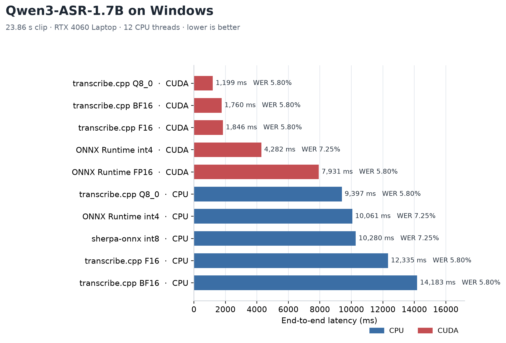
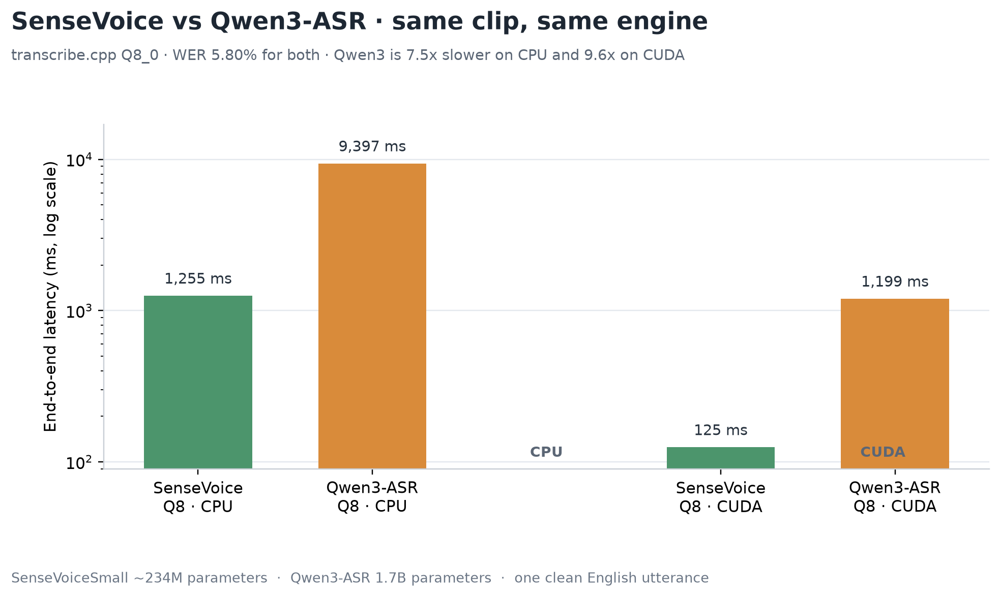

# Windows benchmark

The first table is a historical 4-thread run on Windows 11 with Python 3.13.5,
an AMD Ryzen AI 9 HX 370, one warmup and three measured repetitions. Later
sections use 12 threads, optimized AVX-512 builds, CUDA, or external engines
where explicitly noted. The workload is always the same 23.86-second 16 kHz
LibriSpeech clip used by the Android benchmark. Results include feature
extraction and decoding unless a row is labelled engine-only.

| Engine / model | Mean ms | Median ms | WER |
| --- | ---: | ---: | ---: |
| sherpa-onnx Q8 | 560 | 575 | 5.80% |
| ONNX Runtime Q8 | 899 | 900 | 5.80% |
| ONNX Runtime Q4 | 1,320 | 1,290 | 7.25% |
| ONNX Runtime Q2 | 1,176 | 1,200 | 89.86% |
| MNN Q8 | 798 | 791 | 5.80% |
| MNN Q7 | 804 | 797 | 5.80% |
| MNN Q6 | 804 | 807 | 4.35% |
| MNN Q5 | 812 | 796 | 4.35% |
| MNN Q4 | 687 | 697 | 7.25% |
| MNN Q3 | 969 | 962 | 44.93% |
| MNN Q2 | 933 | 959 | 100.00% (empty output) |
| LiteRT Q8 | 1,061 | 1,061 | 5.80% |
| LiteRT Q4 | 964 | 945 | 7.25% |
| LiteRT Q2 | 1,119 | 1,142 | 100.00% (empty output) |

This is a short single-clip run intended to validate Windows model compatibility
and the CLI measurement path. Three samples are not enough for a stable ranking,
and one utterance does not establish corpus accuracy. The checked-in CLI defaults
to three warmups and ten measured repetitions for follow-up runs.

The CLI now also covers ncnn (INT8 and FP16), GGUF (Q3-K through FP16) and ONNX
Runtime with `--provider cuda`. The table above predates those additions; rerun
the CLI to refresh it.

## All engines (CPU)


Every manifest model folder on CPU, sorted by mean latency (3 warmups, 10
repeats). This chart uses 4 threads and the default AVX2 GGUF build; the CUDA
comparison below uses 12 threads and the AVX-512 build. Best 4-thread result per
engine:

| Engine | Best model | Mean ms | WER |
| --- | --- | ---: | ---: |
| ncnn | `ncnn` (INT8) | 623 | 13.04% |
| ONNX Runtime | `onnx` (Q8) | 904 | 5.80% |
| sherpa-onnx | `onnx` (Q8) | 933 | 5.80% |
| LiteRT | `litert-q4` | 1,047 | 7.25% |
| MNN | `mnn-q4` | 1,075 | 7.25% |
| GGUF | `gguf-q8_0` | 2,169 | 5.80% |

## CPU vs CUDA


ONNX Runtime 1.26.0 and the GGUF CUDA runner, RTX 4060 Laptop, same clip, 3
warmups and 10 repeats. ORT rows use the same 1.26.0 runtime on both providers.
CPU rows use 12 threads; ORT CUDA lets ORT choose its intra-op thread count
because CPU fallback nodes dominate int8 Q8.

| Engine | Model | CPU mean | CUDA mean | Speedup | WER CPU | WER CUDA |
| --- | --- | ---: | ---: | ---: | ---: | ---: |
| ORT | Q8 (int8) | 609 ms | 471 ms | 1.29x | 5.80% | 5.80% |
| ORT | Q4 | 790 ms | 99 ms | 8.0x | 7.25% | 7.25% |
| ORT | Q2 | 1,108 ms | 104 ms | 10.6x | 89.86% | 100.00% (empty) |
| ORT | FP32 | 831 ms | 89 ms | 9.3x | 5.80% | 5.80% |
| GGUF | Q8 | 1,236 ms | 101 ms | 12.2x | 5.80% | 5.80% |
| GGUF | Q4 | 1,461 ms | 92 ms | 15.8x | 7.25% | 7.25% |
| GGUF | FP16 | 1,753 ms | 90 ms | 19.5x | 5.80% | 100.00% (empty) |

CUDA wins on every usable row, but int8 Q8 only by 1.3x. GGUF FP16 runs on CUDA
without errors yet returns empty text, so it is not usable for accuracy.
An ONNX FP16 conversion was also tried: the CPU graph failed validation and the
CUDA graph produced all-NaN logits, so FP16 ONNX is omitted. The working
floating-point GPU result is FP32. `onnx-fp32` is the official unquantized model
at the pinned revision; it is not downloaded by `prepare_models.py`.

## Phase A tuning (Windows)

- The ORT pipeline splits into roughly 43-47 ms fbank/CMVN, 50-60 ms FP32/Q4
  inference and 1.4 ms decode. Feature extraction is almost half of the total,
  so a faster model engine alone cannot go below about 45 ms.
- Setting ORT CUDA `intra_op_num_threads` from 4 to automatic cut Q8 from
  1,050 ms to 471 ms. CPU fallback nodes were the bottleneck, not the GPU.
- GGUF flash attention (`--gguf-flash`) cut CUDA Q8 from 116 to 101 ms and Q4
  from 107 to 92 ms. FP16 is still empty.
- CUDA provider options (`cudnn_conv_algo_search=EXHAUSTIVE`,
  `arena_extend_strategy=kSameAsRequested`, `do_copy_in_default_stream=0`) were
  neutral; `use_tf32=0` was slower (50 to 67 ms for the FP32 graph).
- AVX-512: this Ryzen AI 9 HX 370 reports AVX-512F/DQ/BW/VL/VNNI/VBMI/BF16. The
  ORT wheel contains AVX-512F kernels and the sherpa-ncnn wheel contains AVX-512
  convolution kernels; the MNN and LiteRT wheels do not. The GGUF CPU build was
  AVX2-only, so `tools/build_gguf.py --host --avx512` was added. It improves
  GGUF at 12 threads (Q8 1,346 to 1,236 ms, Q4 1,534 to 1,461 ms) but is worse
  at 4 threads (Q8 2,169 to 2,529 ms).

### BF16

No published BF16 model exists: the upstream ONNX repository ships FP32 and
int8, and the GGUF repository ships FP32, FP16 and Q3-Q8.

- GGUF BF16: the pinned ggml CUDA backend only references BF16 in flash
  attention; it has no general BF16 matmul kernels, so a BF16 GGUF would not be
  GPU-accelerated.
- ONNX FP16: ORT CUDA loads and runs an FP16 graph, but this model produces
  all-NaN logits. Even a MatMul/Gemm-only FP16 graph with FP32 boundary casts
  returned 100% WER (empty text), so FP16 is not usable for SenseVoice here.
  BF16 is stable because it keeps FP32's exponent range.
- ONNX BF16: ORT CUDA can execute a BF16 MatMul (verified on this GPU). A
  MatMul/Gemm-weight BF16 graph with FP32 boundary casts reproduced WER 5.80%
  at 98.2 ms, slower than FP32 at 89.1 ms because of cast and fusion overhead.
  ORT CPU has no BF16 MatMul kernel, so the same model fails on CPU.

ONNX-level BF16 is not a speed win. TensorRT BF16 is the exception and is
covered next.

## TensorRT (external engine)

TensorRT has no SenseVoice API. `tools/tensorrt_benchmark.py` builds a
fixed-shape plan from the official FP32 ONNX and runs it with BF16, FP16, or
FP32.

Results on the RTX 4060 Laptop, 23.86 s clip:

| Configuration | Engine ms | End-to-end | WER |
| --- | ---: | ---: | ---: |
| BF16, fixed 398 frames | 32-40 | ~70-90 ms | 5.80% |
| BF16, dynamic 64-3000 frames | 65.6 | ~109 ms | 5.80% |
| FP32, fixed 398 frames | 39.3-41.8 | ~78-84 ms | 5.80% |

BF16 is the fastest measured GPU path, about 1.4-1.7x faster than ORT FP32 on the
model segment; end-to-end the two are closer (70-90 ms vs 89-96 ms) because
fbank dominates and laptop clocks vary. The gain requires a fixed or bucketed
shape; the dynamic plan is slower than ORT. Engine builds took 50-172 s and
produced 544-990 MB files.

Setup:

1. Download the TensorRT 10.13.3 Windows CUDA 12.9 zip, extract it, and keep
   `lib/` available. The tested URL was
   `https://developer.download.nvidia.com/compute/machine-learning/tensorrt/10.13.3/zip/TensorRT-10.13.3.9.Windows.win10.cuda-12.9.zip`.
   The Python wheel is inside `python/`; this machine used
   `tensorrt-10.13.3.9-cp313-none-win_amd64.whl`.
2. Create the environment and install the Python dependencies:

   ```powershell
   python -m venv .native/trt-env
   .native/trt-env/Scripts/python.exe -m pip install -r tools/tensorrt-requirements.txt
   .native/trt-env/Scripts/python.exe -m pip install .native/tensorrt/TensorRT-10.13.3.9/python/tensorrt-10.13.3.9-cp313-none-win_amd64.whl
   ```

3. Prepare the official FP32 ONNX in the Windows benchmark environment. The
   baseline models are required for tokens and license files:

   ```powershell
   python tools/prepare_models.py
   python tools/prepare_low_precision.py --fp32
   ```

4. Build and run. The engine is built on first use and reused afterwards;
   `--frames` is the LFR frame count (398 for the 23.86 s clip). Pass
   `--tensorrt-lib` if the SDK `lib/` is not on `PATH`.

   ```powershell
   .native/trt-env/Scripts/python.exe tools/tensorrt_benchmark.py `
     --precision bf16 --frames 398 --build `
     --tensorrt-lib .native/tensorrt/TensorRT-10.13.3.9/lib
   ```

   Use `--frames 200` for 12 s, `400` for 24 s, `500` for 30 s, or `800` for
   48 s. Use `--precision fp16` or `fp32` for the other builder modes. The tool
   writes JSON with `--output`.

## transcribe.cpp (external engine)

The same 23.86 s clip was also run through handy-computer/transcribe.cpp
SenseVoiceSmall GGUFs (release 0.4.1) as an external cross-check. CPU used 12
threads with the CPU+Vulkan package's cascadelake AVX-512 module; CUDA used
CUDA0. All rows produced WER 5.80%.

| Model | CPU | CUDA | CUDA speedup |
| --- | ---: | ---: | ---: |
| Q8_0 | 1,255 ms | 125 ms | 10.0x |
| F16 | 1,353 ms | 137 ms | 9.9x |
| F32 | 1,365 ms | 152 ms | 9.0x |
| BF16 | 1,449 ms | 136 ms | 10.7x |

BF16 is not in the upstream catalog; `tools/convert_gguf_bf16.py` converts the
F16 GGUF's 281 F16 tensors to BF16 while keeping the 638 F32 tensors. The CUDA
wheel's bundled generic CPU backend was 6-12x slower than the CPU+Vulkan
package's AVX-512 module, so CPU numbers depend heavily on which ggml-cpu module
is loaded. transcribe.cpp CUDA Q8 (125 ms) is slower than GGUF CUDA Q8 (97 ms),
ORT FP32 (89-96 ms) and fixed-shape TensorRT BF16 (70-90 ms).

Setup:

1. Install the release 0.4.1 Python wheels from the transcribe.cpp GitHub
   release (`https://github.com/handy-computer/transcribe.cpp/releases/tag/v0.4.1`):
   `transcribe_cpp-0.4.1-py3-none-any.whl` and
   `transcribe_cpp_native_cu12-0.4.1-py3-none-win_amd64.whl`.
2. Download the SenseVoice GGUFs from
   `https://huggingface.co/handy-computer/SenseVoiceSmall-gguf`, for example
   `SenseVoiceSmall-Q8_0.gguf` (2.19 GB), `SenseVoiceSmall-F16.gguf` (4.09 GB),
   or `SenseVoiceSmall-F32.gguf`.
3. For the fast CPU path, download the
   `transcribe-native-0.4.1-windows-x86_64-cpu-vulkan.tar.gz` release asset and
   pass its `transcribe.dll` with `--library`. Without it, the CUDA wheel's
   generic CPU module is used and is much slower.

```powershell
python -m venv .native/transcribe-env
.native/transcribe-env/Scripts/python.exe -m pip install -r tools/transcribe-requirements.txt
.native/transcribe-env/Scripts/python.exe -m pip install `
  .native/transcribe-bin/transcribe_cpp-0.4.1-py3-none-any.whl `
  .native/transcribe-bin/transcribe_cpp_native_cu12-0.4.1-py3-none-win_amd64.whl
```

Run CUDA, CPU, or another backend:

```powershell
.native/transcribe-env/Scripts/python.exe tools/transcribe_benchmark.py `
  --model .native/models/transcribe/SenseVoiceSmall-Q8_0.gguf --device cuda
.native/transcribe-env/Scripts/python.exe tools/transcribe_benchmark.py `
  --model .native/models/transcribe/SenseVoiceSmall-Q8_0.gguf `
  --device cpu --threads 12 `
  --library .native/transcribe-bin/cpu/transcribe-native-windows-x86_64-cpu-vulkan/transcribe.dll
```

Create a BF16 GGUF with the Windows benchmark environment:

```powershell
.native/model-env/Scripts/python.exe tools/convert_gguf_bf16.py `
  .native/models/transcribe/SenseVoiceSmall-F16.gguf `
  .native/models/transcribe/SenseVoiceSmall-BF16.gguf
```

`--device` also accepts `vulkan` and `igpu`. The tool writes JSON with
`--output`; the model must be a 16 kHz mono WAV.

## Qwen3-ASR-1.7B

Qwen3-ASR is a 1.7B audio-LLM, not another SenseVoice graph. It uses a
Whisper-style encoder, an MRoPE decoder and a split `decoder_init` /
`decoder_step` KV-cache export. The same 23.86 s clip was used. Measurements
were taken on the RTX 4060 Laptop (8 GB) and Ryzen AI 9 HX 370 with 12 CPU
threads, transcribe.cpp 0.4.1, sherpa-onnx 1.13.8, ONNX Runtime 1.30.0 (CPU) or
1.26.0 (CUDA), and transformers 4.57.6.

| Engine / precision | Provider | ms | RTF | WER |
| --- | --- | ---: | ---: | ---: |
| transcribe.cpp Q8_0 | CUDA | 1,199 | 0.050 | 5.80% |
| transcribe.cpp F16 | CUDA | 1,846 | 0.077 | 5.80% |
| transcribe.cpp BF16 | CUDA | 1,760 | 0.074 | 5.80% |
| transcribe.cpp Q8_0 | CPU | 9,397 | 0.394 | 5.80% |
| transcribe.cpp F16 | CPU | 12,335 | 0.517 | 5.80% |
| transcribe.cpp BF16 | CPU | 14,183 | 0.594 | 5.80% |
| sherpa-onnx int8 | CPU | 10,280 | 0.431 | 7.25% |
| ONNX Runtime int4 | CPU | 10,061 | 0.422 | 7.25% |
| ONNX Runtime int4 | CUDA | 4,282 | 0.179 | 7.25% |
| ONNX Runtime FP16 | CUDA | 7,931 | 0.332 | 5.80% |

transcribe.cpp and sherpa-onnx rows are medians of repeated runs. ORT rows sum
the measured mel, encoder, prefill and decode medians; they are not a single
wall-clock median. CUDA transcribe rows used 3 warmups and 10 repeats, except
F16/BF16 (5 repeats). CPU transcribe rows used 2 warmups and 3 repeats;
sherpa-onnx used 2 warmups and 5 repeats; ORT used 3 warmups and 10 repeats.

Q8 transcribe.cpp on CUDA is the fastest measured path here at 1.21 s, 8.5x
faster than sherpa-onnx CPU and 3.5x faster than ORT int4 CUDA. The 4-bit ORT
CUDA path is the fastest ORT variant (4.28 s); FP16 CUDA is slower (7.93 s)
because the FP16 decoder is memory-bound and its 3.4 GB step weights plus KV
cache leave little headroom on an 8 GB laptop GPU. The FP16 encoder itself took
about 32 ms; the decoder dominates. F16/BF16 CUDA transcribe variants are also
slightly slower than Q8.

Accuracy is a single-clip check, not a corpus result. transcribe.cpp
Q8/F16/BF16 and ORT FP16 produced WER 5.80%. The int4 and sherpa int8 paths
produced 7.25% on this clip ("Saint Saverre" and "savior" instead of the
reference spelling). That difference is precision-related here, but one
utterance is not enough to rank accuracy.



BF16 is available through transcribe.cpp. There is no ORT BF16 export in the
community split-ONNX package, so ORT BF16 was not run. TensorRT-LLM was not used:
it has no production Qwen3-ASR audio-tower implementation and no current Windows
wheel path for this model.

### Qwen3-ASR vs SenseVoice



For this clip and the same transcribe.cpp Q8_0 engine, SenseVoice is the clear
winner: 125 ms vs 1,199 ms on CUDA (9.6x), and 1,255 ms vs 9,397 ms on CPU
(7.5x). Both produce WER 5.80%. Qwen3 int4 and sherpa int8 are slower than
SenseVoice and slightly less accurate on this clip (7.25%).

That does not mean Qwen3 is a worse model in general. It is a 1.7B
autoregressive audio-LLM, versus the roughly 234M-parameter CTC-style
SenseVoiceSmall. Qwen3 generates 85-86 decoder tokens here, so decode time
dominates; its potential advantages are multilingual coverage, robustness on
harder audio, and LLM-side context, none of which this clean English
LibriSpeech utterance exercises. For low-latency English transcription,
SenseVoiceSmall remains the better choice on this evidence. A multilingual or
noisy corpus is required before claiming a Qwen3 quality advantage. The two
charts are generated by `tools/plot_qwen3_benchmark.py`.

### Qwen3-ASR setup

The model files are large and are not checked in. The preparation script
downloads from the mirror used here; pass `--endpoint https://huggingface.co`
when the official endpoint is reachable.

```powershell
python -m venv .native/model-env
.native/model-env/Scripts/python.exe -m pip install -r tools/qwen3-asr-requirements.txt
.native/model-env/Scripts/python.exe tools/prepare_qwen3_asr.py --components all
python -m venv .native/gpu-env
.native/gpu-env/Scripts/python.exe -m pip install -r tools/qwen3-asr-gpu-requirements.txt
```

Sources:

- transcribe.cpp GGUFs: `handy-computer/Qwen3-ASR-1.7B-gguf`
- split ONNX int4/FP16: `tonythethompson/Qwen3-ASR-1.7B-ONNX`, revision
  `6c07a3dfed80e1cc64e10cad108b00c2080ae19b`
- sherpa-onnx int8: `thieunv-asilla/sherpa-onnx-qwen3-asr-1.7B-int8`, revision
  `69eb686fd94a4a865bb5340a3d6ac0d7f1fec0d5`
- chat template: `Qwen/Qwen3-ASR-1.7B`, revision
  `7278e1e70fe206f11671096ffdd38061171dd6e5`

The adapters build the official chat prompt, insert one `<|audio_pad|>` per
encoder output frame, set `audio_offset` to the first audio pad, and strip the
leading `language ...<asr_text>` prefix before WER. The feature extractor uses
`padding="longest"`; this clip produces 2,386 mel frames and 310 audio features.

Direct ORT CPU and int4 CUDA:

```powershell
.native/model-env/Scripts/python.exe tools/qwen3_asr_ort.py `
  --model-dir .native/models/qwen3-asr/ort-int4/extracted/qwen3-asr-1.7b-int4 `
  --provider cpu --threads 12 --warmups 3 --repeats 10
.native/gpu-env/Scripts/python.exe tools/qwen3_asr_ort.py `
  --model-dir .native/models/qwen3-asr/ort-int4/extracted/qwen3-asr-1.7b-int4 `
  --provider cuda --warmups 3 --repeats 10
```

FP16 CUDA needs two processes on an 8 GB card: the encoder session is released
before the decoder sessions are loaded, and its features are reused.

```powershell
.native/gpu-env/Scripts/python.exe tools/qwen3_asr_ort.py `
  --model-dir .native/models/qwen3-asr/ort-fp16 --provider cuda `
  --encoder-only --features-out .native/models/qwen3-asr/ort-fp16/features.npy
# Use encoderMs from the command above.
.native/gpu-env/Scripts/python.exe tools/qwen3_asr_ort.py `
  --model-dir .native/models/qwen3-asr/ort-fp16 --provider cuda `
  --features .native/models/qwen3-asr/ort-fp16/features.npy `
  --encoder-ms 32 --warmups 3 --repeats 10
```

sherpa-onnx and transcribe.cpp:

```powershell
.native/model-env/Scripts/python.exe tools/qwen3_asr_sherpa.py `
  --model-dir .native/models/qwen3-asr/sherpa --provider cpu `
  --threads 12 --warmups 2 --repeats 5
.native/transcribe-env/Scripts/python.exe tools/transcribe_benchmark.py `
  --model .native/models/qwen3-asr/transcribe/Qwen3-ASR-1.7B-Q8_0.gguf `
  --device cuda `
  --library .native/transcribe-bin/cuda/transcribe-native-windows-x86_64-cuda/transcribe.dll
.native/transcribe-env/Scripts/python.exe tools/transcribe_benchmark.py `
  --model .native/models/qwen3-asr/transcribe/Qwen3-ASR-1.7B-Q8_0.gguf `
  --device cpu --threads 12 `
  --library .native/transcribe-bin/cpu/transcribe-native-windows-x86_64-cpu-vulkan/transcribe.dll
```

## GPU-only comparison


End-to-end latency on the same 23.86 s clip. TensorRT uses a prebuilt 398-frame
BF16 engine; the dynamic-profile engine is shown for contrast and is slower than
ORT. transcribe.cpp includes its own mel/encoder/decoder. All rows produced WER
5.80%. TensorRT's advantage is the model segment (32-40 ms); fbank (~40-50 ms)
and laptop clocks dominate the total, so the end-to-end gap over ORT varies from
about 7% to 20%.

## Shape and chunk length

The model input is `x: [1, T, 560]`; each `T` step is one LFR frame, or 60 ms of
audio. `T` fixes the audio duration, the attention cost (quadratic in `T`), the
output size (`(T + 4) x 25055` floats) and which shapes a fixed engine accepts.

Fixed-shape BF16 TensorRT, engine-only:

| Audio | T | Engine ms | RTF | xRealtime |
| --- | ---: | ---: | ---: | ---: |
| 12 s | 200 | 23.2 | 0.0019 | 517x |
| 24 s | 400 | 34.8 | 0.0014 | 690x |
| 48 s | 800 | 56.3 | 0.0012 | 853x |
| 96 s | 1,600 | 162.2 | 0.0017 | 592x |

Padding the 23.86 s clip to 48 s kept WER at 5.80%; padding to 96 s raised it to
7.25%. The practical chunk is 20-30 s: near-best RTF, lower per-chunk latency,
and close to the training distribution. Use 48 s only when throughput matters;
avoid chunks beyond 60-96 s because attention cost and accuracy both degrade.

A direct 30 s (T=500) test, using isolated component medians:

| Audio | Engine ms | Engine RTF | fbank ms | fbank ms/s | Est. total ms/s |
| --- | ---: | ---: | ---: | ---: | ---: |
| 24 s | 34.1 | 0.00142 | 37.9 | 1.58 | 3.06 |
| 30 s | 37.4 | 0.00125 | 45.9 | 1.53 | 2.83 |
| 48 s | 55.9 | 0.00116 | 72.8 | 1.52 | 2.74 |

48 s is about 3% more efficient than 30 s and about 10% more than 24 s in
sequential end-to-end throughput. 30 s is not the absolute optimum, but it has
lower per-chunk latency and is closer to the training length. Combined CPU+GPU
runs on this laptop varied by 10-20% because the CPU and GPU share a power
budget; if throughput matters, pipeline fbank for chunk N+1 with inference for
chunk N instead of comparing sequential totals.
Feature extraction adds roughly 1.8 ms per audio second, so end-to-end RTF
differences between 24 s and 48 s are smaller than the engine-only table shows.
